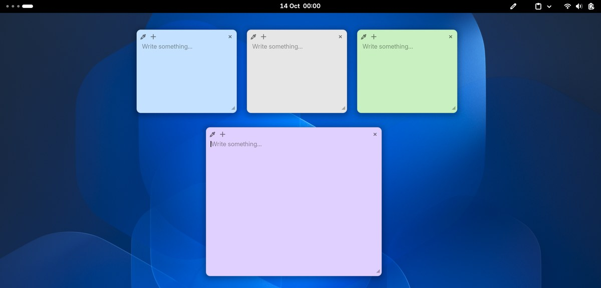

# Sticky Notes for GNOME Shell

Lightweight sticky notes that sit on your desktop, above windows and below the top bar. Supports GNOME Shell 50 and 51.



## Features

- **Panel icon** — left-click shows or hides all notes (creates one if none exist). Right-click for:
  - New Note, Show/Hide Notes (each with its keyboard shortcut)
  - Restore Closed (last 10 closed notes are kept)
  - Arrange: **Tile**, **Cascade**, **Gather** (groups notes around the centre of the screen at their current size; when the screen is full, notes round the edge run partly off screen with at least half showing, and any still left over are gathered in a layer on top that leaves every title bar below uncovered; every note stays clickable), **Restore Layout** (puts notes back where you had them before the first Tile, Cascade or Gather; switching between arrangements keeps your own note sizes, which only Tile changes)
  - Options: **Focus On Edit** — enlarge and centre a note while you edit it (off by default); **Live Markdown** — while editing, show every line except the one you're on with its Markdown styled in place, and `- ` list items as bullets (off by default; notes are always saved with plain `-`); **Snap Notes** — when you let go of a moved or resized note, line it up with nearby notes (and the screen edges), with guide lines while dragging (off by default); **Preferences…** — change the shortcuts, snapping options and the folder notes are stored in
- **Notes** — drag by the top bar, resize from the bottom-right corner, cycle through six colours, **+** to add a note beside the current one, **×** to close (second click within 3 s confirms if the note has text).
- **Placement** — new notes rotate colour automatically and are placed in free space so they don't overlap existing notes.
- **Markdown** — notes render Markdown when not being edited; click to edit, click away or press `Esc` to render. While you type in a note, the app you were using is shown as inactive; `Esc` or a click anywhere outside the notes hands the keyboard back to it. Supports headings, **bold**, *italic*, ~~strikethrough~~, `inline code`, fenced code blocks, bullet and numbered lists, quotes, horizontal rules, links (shown underlined) and task lists — `- [ ]` / `- [x]` checkboxes can be ticked directly in the rendered view.
- **Shortcuts** — `Super`+`Alt`+`N` new note, `Super`+`Alt`+`H` show/hide notes. Both are shown in the menu and can be changed from **Preferences…** (or the Extensions app).
- In the Overview, notes appear (scaled, not clickable) on the workspace you opened it from, in its preview and its thumbnail, while they're shown; they're hidden over fullscreen windows.

By default, notes are stored locally as JSON in `~/.local/share/sticky-notes/` and nothing leaves your machine.

### Syncing between computers

In **Preferences → Storage**, choose a folder that a sync tool keeps in step between your computers (for example [Syncthing](https://syncthing.net/) or a Nextcloud client folder), and choose the same folder on each computer. Notes already in that folder are merged with your current notes.

- Only the text and colour of each note are synced, in `notes.json`. Positions, sizes, stacking and show/hide stay separate on each computer, in `~/.local/share/sticky-notes/layout.json`. A note that arrives from another computer is placed in free space.
- Changes from other computers show up as soon as the sync tool writes them. If the same note was edited on two computers, the most recent edit wins. A note deleted on one computer is deleted on the others too, unless it was edited after it was deleted. **Restore Closed** works on every computer.
- Conflicting copies made by Syncthing (`notes.sync-conflict-….json`), Nextcloud or Dropbox (`notes (… conflicted copy …).json`) are merged in and then removed.
- Each computer's clock decides which edit is newest, so keep the clocks set automatically.
- A network share (NFS or SMB) works, but changes saved by another computer only appear after your next edit here or your next login. GNOME Shell may also freeze while the share can't be reached, so a sync tool is the better choice.

## Install

Download `sticky-notes.shell-extension.zip` from the [latest release](https://github.com/runnylogan/gnome-shell-sticky-notes/releases/latest), then:

```bash
gnome-extensions install --force sticky-notes.shell-extension.zip
```

Log out and back in (Wayland), then enable it:

```bash
gnome-extensions enable sticky-notes@runnylogan
```

## Install from source

```bash
git clone https://github.com/runnylogan/gnome-shell-sticky-notes.git
cd gnome-shell-sticky-notes
gnome-extensions pack --force --extra-source=markdown.js --extra-source=prefs.js --extra-source=icons
gnome-extensions install --force sticky-notes@runnylogan.shell-extension.zip
```

Then log out and back in and enable it as above.

## Licence

GPL-2.0-or-later — see [LICENSE](LICENSE).
